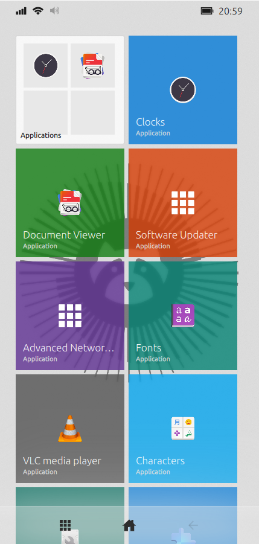

# Eternity Shell

A touch-first Wayland shell and compositor built with **Qt 6**, **Qt Quick**, and **Qt Wayland Compositor**. Eternity Shell brings a tile-based interface to Linux: a live app launcher, folders, full-screen app surfaces, a background-app switcher, and a pull-down quick settings shade.

<p align="center">
  
</p>

> **Status:** early prototype. The compositor and shell UI work, but several system integrations (battery, network, notifications, and some demo tiles) are currently placeholders. See [Project status](#project-status).

## Features

- **Wayland compositor** — embeds a Wayland compositor with xdg-shell support and server-side decorations.
- **Live application launcher** — discovers installed apps from XDG `.desktop` files, resolves their icons, and launches them with their `Exec` command.
- **Tile home screen** — colorful, responsive app tiles with frosted-glass styling and depth/perspective effects.
- **Folders** — group apps into folder tiles with animated open/close transitions.
- **Full-screen apps** — app surfaces are maximized behind the shell UI and shown with a rotating cube-style transition.
- **Background app switcher** — browse running surfaces as cards, focus one, or close it.
- **Quick settings shade** — pull down from the top for Wi-Fi, Bluetooth, mobile, sound, and brightness controls plus notifications.
- **Status bar** — live clock, battery, cellular, Wi-Fi, and silent-mode indicators with automatic light/dark glyph adjustment.
- **Touch navigation bar** — Ubuntu Touch-style back, home, and app-switcher buttons.
- **Adaptive layout** — switches between a two-column phone layout and a four-column tablet/desktop layout.
- **Configurable appearance** — wallpaper, dimming, tile opacity, and tile blur can be changed in `eternityshell.ini`.
- **Keyboard shortcuts** — `Esc` goes back and `Ctrl+Shift+S` toggles the quick settings shade.
- **Bundled assets** — custom inline SVG icon set and the Ubuntu font family.

## Requirements

- Linux with X11 or XWayland (the app currently uses the `xcb` platform plugin for compability reasons)
- CMake 3.16 or newer
- A C++ compiler
- Qt 6.8 or newer with:
  - Qt Quick
  - Qt Wayland Compositor
  - Qt Quick Effects
  - Qt Quick Controls

On Debian/Ubuntu, the development packages can be installed with:

```bash
sudo apt install build-essential cmake \
  qt6-base-dev qt6-declarative-dev qt6-wayland-dev \
  qml6-module-qtquick qml6-module-qtquick-window \
  qml6-module-qtquick-controls qml6-module-qtquick-effects \
  qml6-module-qtwayland-compositor
```

Package names vary between distributions; on other systems use your Qt 6 SDK or package manager.

## Building

From the project root:

```bash
cmake -S . -B build -DCMAKE_BUILD_TYPE=Release
cmake --build build -j"$(nproc)"
```

Run the shell:

```bash
./build/appeternityshell
```

The compositor opens in a window at 450×900 by default, which makes it easy to develop and test on a regular desktop. You can also open the project in Qt Creator by selecting `CMakeLists.txt`.

## Running Wayland apps

Eternity Shell exposes a Wayland socket named `eternityshell`. With the shell running, start a client with:

```bash
WAYLAND_DISPLAY=eternityshell <application>
```

For Qt applications, make sure the Wayland platform plugin is selected:

```bash
QT_QPA_PLATFORM=wayland WAYLAND_DISPLAY=eternityshell ./your-app
```

## Configuration

Settings are stored in `eternityshell.ini`, next to the executable. The file is created automatically on first launch with these defaults:

```ini
[Wallpaper]
path=
dim=0.12

[Tiles]
opacity=0.78
blur=0.25
```

| Key | Description | Range |
| --- | --- | --- |
| `Wallpaper/path` | Wallpaper image path. Supports absolute paths, `~/`, and paths relative to the config file. | — |
| `Wallpaper/dim` | Dark overlay strength over the wallpaper. | `0.0`–`1.0` |
| `Tiles/opacity` | Glass opacity of launcher tiles. | `0.15`–`1.0` |
| `Tiles/blur` | Wallpaper tile blur amount. | `0.0`–`1.0` |

Example:

```ini
[Wallpaper]
path=~/Pictures/wallpapers/eternity.jpg
dim=0.18

[Tiles]
opacity=0.8
blur=0.3
```

The saved launcher order is kept separately in Qt's user settings (`EternityShell/Launcher`).

## Project structure

```text
CMakeLists.txt          CMake project and QML module definition
main.cpp                Application entry point, fonts, and context objects
Main.qml                Compositor, shell surfaces, home screen, shade, navigation
desktopappmodel.*       XDG .desktop discovery and application launching
shellconfig.*           Persistent wallpaper and tile appearance settings
components/             Reusable QML UI components
components/icons/       Inline SVG icon components
theme/Theme.qml         Colors, spacing, and sizing tokens
font/                   Bundled Ubuntu font family
icons/                  Additional image assets
docs/                   Documentation assets (screenshot)
```

## Keyboard shortcuts

| Shortcut | Action |
| --- | --- |
| `Esc` | Close the quick settings shade, folder, or app drawer |
| `Ctrl+Shift+S` | Open or close the quick settings shade |

## Project status

This project is under active development and is not yet a daily-driver shell. Current limitations:

- Battery, Wi-Fi, cellular, Bluetooth, and notification values are UI placeholders rather than system integrations.
- The static demo tiles (Browser, Messages, Music, Photos, and others) are visual placeholders.
- The search button in the app drawer is not wired up yet.
- The compositor runs as a window inside an existing desktop session; it does not yet take over a display directly through DRM/KMS.
- No automated tests are included yet.

## Credits

- Uses the **Ubuntu** font family, bundled under the Ubuntu Font Licence.
- Built with [Qt](https://www.qt.io/) and the Qt Wayland Compositor module.

## License

Licensed under the [Apache License 2.0](LICENSE).
